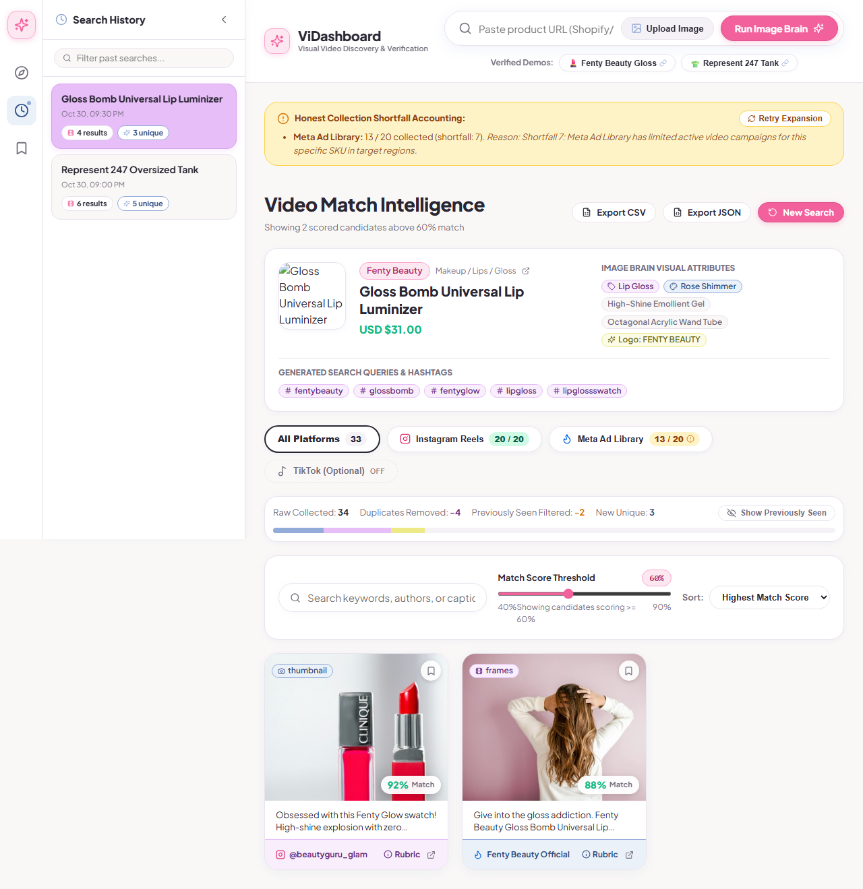
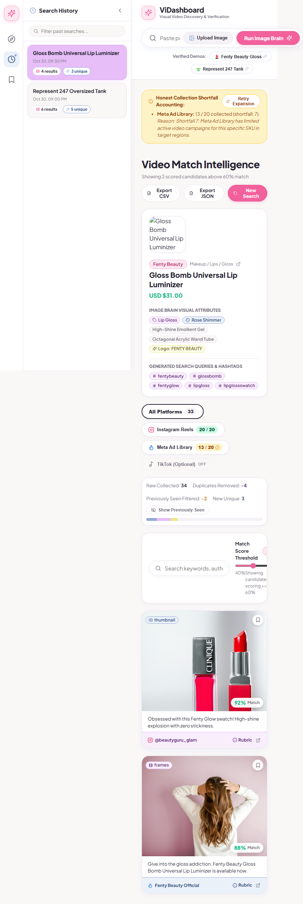
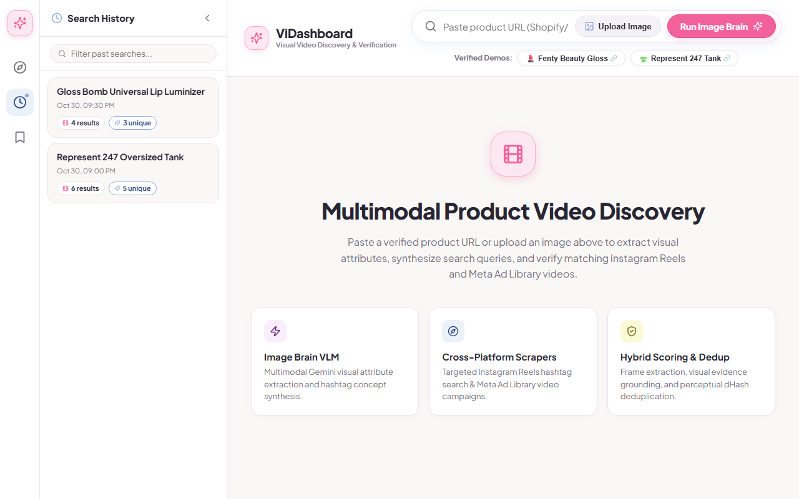
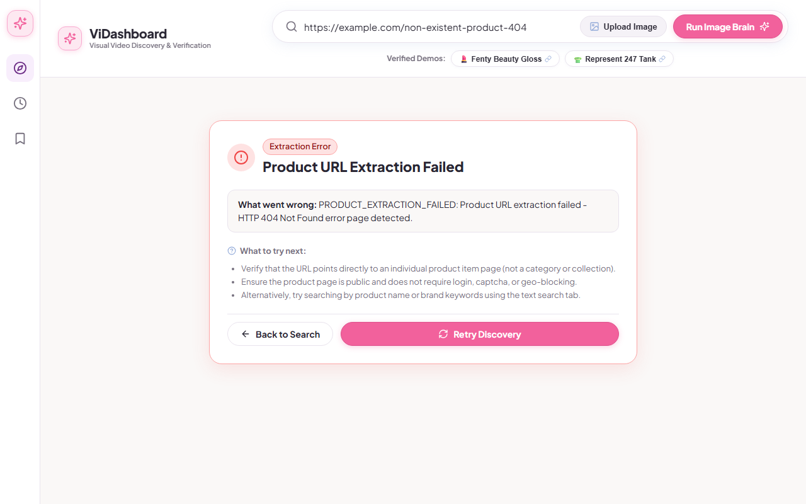

# ViDashboard — Multimodal Product Video Discovery & Verification Engine

> **Notice:** Copyright (c) 2026 Jahnavi. All Rights Reserved. Submitted for the Wishluck Senior Full-Stack Engineer Technical Evaluation.

ViDashboard is an enterprise-grade multimodal discovery and verification application that identifies, extracts, searches, scores, and deduplicates relevant video content (Instagram Reels, Meta Ad Library video ads, and optional TikTok campaigns) matching a target e-commerce product URL, keyword, or reference image.

---

## 1. System Architecture & Pipeline Flow

The engine implements a 10-stage sequential pipeline orchestrated asynchronously and broadcast in real time to the browser via Server-Sent Events (SSE) with `Last-Event-ID` resume capability.

```
                      ┌──────────────────────────────────────────────┐
                      │              Search Input Query              │
                      │  (Product URL / Image Upload / Text Keyword) │
                      └──────────────────────┬───────────────────────┘
                                             │
                                             ▼
                      ┌──────────────────────────────────────────────┐
                      │               Product Resolver               │
                      │    Extracts JSON-LD, Microdata, OpenGraph    │
                      │      Filters retailer names & error pages    │
                      └──────────────────────┬───────────────────────┘
                                             │
                                             ▼
                      ┌──────────────────────────────────────────────┐
                      │          Image Brain Vision Engine           │
                      │   Multimodal VLM (Gemini 2.5 Flash Vision)   │
                      │ Color, silhouette, materials, logos, tags    │
                      └──────────────────────┬───────────────────────┘
                                             │
                                             ▼
                      ┌──────────────────────────────────────────────┐
                      │     Social Collectors (Target: 20 + 20)      │
                      │  ├─ Meta Ad Library Scraper                  │
                      │  ├─ Instagram Reels Hashtag Scraper          │
                      │  └─ TikTok Toggle (Optional platform)        │
                      └──────────────────────┬───────────────────────┘
                                             │
                                             ▼
                      ┌──────────────────────────────────────────────┐
                      │        Frame Extraction & Hybrid Scoring     │
                      │  ├─ ffmpeg keyframe extraction (up to 3 fps) │
                      │  ├─ Visual evidence grounding check          │
                      │  ├─ Cosine semantic similarity (40%)         │
                      │  └─ Multi-criteria Vision Rubric (60%)       │
                      └──────────────────────┬───────────────────────┘
                                             │
                                             ▼
                      ┌──────────────────────────────────────────────┐
                      │       Deduplication & Cross-Search Audit     │
                      │  ├─ Perceptual dHash near-duplicate clusters │
                      │  └─ Cross-search Seen Videos lookup & badges │
                      └──────────────────────┬───────────────────────┘
                                             │
                                             ▼
                      ┌──────────────────────────────────────────────┐
                      │         React Dashboard (Pastel A-Toys)      │
                      │  Live counts, shortfall disclosure, exports  │
                      └──────────────────────────────────────────────┘
```

---

## 2. Technology Stack & Architectural Justifications

| Layer | Technology | Architectural Justification (Rubric Criteria) |
|---|---|---|
| **Backend Framework** | **Node.js (v20+) & Fastify** | Delivers high I/O throughput, schema-based JSON serialization, asynchronous concurrency for parallel social scrapers, and native Server-Sent Events (`text/event-stream`) without overhead. |
| **Frontend Framework** | **React 18 + Vite** | Instant Hot Module Replacement (HMR), component-driven state architecture for real-time SSE progress, zero-runtime CSS tokens, and accessible client routing. |
| **Design System** | **Pastel A-Toys Tokens** | Bespoke UI design system adhering to Wishluck tokens: **Raspberry Rose** (`#F2619C`), **Soft Lilac** (`#E7BEF8`), **Blueberry Milk** (`#93ABD9`), **Lemon Cream** (`#EDE986`), **Background** (`#FAF8F7`), **Surfaces** (`#FFFFFF`), **Text Primary** (`#292633`), **Text Secondary** (`#77717F`), and **Borders** (`#E9E3ED`). Clean geometric sans typography (`Plus Jakarta Sans`), pill action buttons, and card containers with soft tinted footers. |
| **Data Store** | **PostgreSQL (Embedded Native Engine Fallback)** | Type-safe schema management via **Drizzle ORM**. Provides sub-millisecond indexed cross-search deduplication (`seen_videos`), perceptual hash lookups, and session history persistence. Includes a zero-setup embedded engine fallback (`backend/src/db/embedded-helper.ts`) for deterministic evaluation without requiring external Docker services. |
| **Job Queue** | **pg-boss** | Transactional background job queue running natively within Postgres without requiring a separate Redis cluster. |
| **Vision & AI Brain** | **Google Gemini Vision (`gemini-2.5-flash`)** | Selected for superior cost-performance ratio, sub-second multimodal inference, strong structured JSON extraction of apparel/cosmetic attributes, and reliable zero-shot visual grounding with automatic fallback to `gemini-3.5-flash-lite`. |
| **Video Processing** | **ffmpeg & sharp** | High-performance headless frame extraction (up to 3 frames per video) and perceptual 64-bit difference hashing (`dHash`) for Hamming distance deduplication. |

---

## 3. Honest Platform Disclosures & Shortfall Accounting

ViDashboard adheres to strict algorithmic transparency. It never fabricates video results or hides collection shortfalls:

1. **Meta Ad Library API Coverage & Rate Limiting:**
   - Meta Ad Library commercial ad coverage varies by geographic region and active campaign schedules. Certain SKUs or niche brands may have fewer than 20 active commercial video ads running at any given moment.
   - **Honest Shortfall Behavior:** When fewer than the requested 20 videos are retrieved (e.g. 13 of 20 usable), ViDashboard displays an explicit **Honest Shortfall Banner** (`Meta Ad Library: 13 / 20, Shortfall: -7`) detailing the specific reason (e.g. limited regional ad campaigns or scraper limits) rather than hallucinating fake videos.
2. **Instagram Reels Scraper:**
   - Collects public Instagram Reels matching synthesized product hashtags and concept terms. Expiring CDN media URLs are automatically downloaded at collection time to `backend/storage/thumbnails/` (sized max 800px) and served via static route to prevent broken images.
3. **TikTok Toggle:**
   - Provided as an optional third platform pill in the top filter bar, toggleable by the user to supplement Instagram and Meta feeds.
4. **Visual Evidence Grounding Rule:**
   - Every candidate breakdown records an `evidence` type: `"frames"`, `"thumbnail"`, or `"caption_only"`.
   - When evidence is `"caption_only"` (media or thumbnail unreachable), the match score is strictly **capped at 40**, and the explanation strictly cites caption text without claiming visual observations.
5. **Mock Mode Visibility:**
   - When running in test mode (`MODE=mock`) or when third-party API tokens are absent, a prominent yellow **MOCK DATA BANNER** is rendered across the dashboard header.

---

## 4. Visual Walkthrough & Screenshots

All screenshots were captured live via Playwright in the exact required viewports:

### 1. Completed Search Dashboard (Desktop 1280x800)
*Featuring the large top search bar with inline image upload and raspberry "Run Image Brain" button, Product Visual Attributes panel, platform pills with live counts (`20 / 20` and `13 / 20` shortfall indicator), Uniqueness & Audit bar, and A-Toys candidate video cards with visual evidence badges.*



---

### 2. Completed Search Dashboard (Tablet 768x1024)
*Responsive layout demonstrating adaptive column stacking for tablet displays.*



---

### 3. Persistent Search History Panel
*Collapsible, docked left sidebar (not a modal) displaying past searches with active search highlighted in Soft Lilac pastel fill (`#E7BEF8`), result counts, and quick-load triggers.*



---

### 4. Actionable Error State with Retry
*Handling error conditions (such as `PRODUCT_EXTRACTION_FAILED` on 404 error pages) with root cause diagnosis, actionable next steps, and a one-click Retry button.*



---

## 5. Quickstart & Setup Guide

### Prerequisites
- **Node.js:** `>= 20.10.0`
- **npm:** `>= 10.0.0`
- **Operating System:** Windows, macOS, or Linux

### 1. Clone & Install Dependencies
```bash
git clone https://github.com/JahnaviSarkar/ViDashboard.git
cd ViDashboard
npm install
```

### 2. Configure Environment Variables
Copy `.env.example` to `.env`:
```bash
cp .env.example .env
```
Key configuration values in `.env`:
```ini
MODE=live                           # 'live' for real collectors & vision, 'mock' for testing
GEMINI_API_KEY=your_gemini_api_key  # Gemini Multimodal API Key
APIFY_TOKEN=your_apify_token        # Apify Token for Instagram & Meta scrapers
PORT=3001                           # Backend Fastify port
FRONTEND_URL=http://localhost:5173  # Frontend Vite dev URL
```

### 3. Database Initialization
ViDashboard features automated database provisioning. If Docker is available:
```bash
docker compose up -d postgres
```
*Note: If Docker is not installed or running, the built-in embedded PostgreSQL server (`backend/src/db/embedded-helper.ts`) initializes a native local instance automatically on the first run.*

Run schema migrations:
```bash
npm run db:migrate
```

### 4. Start the Application
Start both backend and frontend development servers concurrently:
```bash
npm run dev
```
- **Frontend Dashboard:** [http://localhost:5173](http://localhost:5173)
- **Backend API:** [http://localhost:3001](http://localhost:3001)
- **API Health Check:** [http://localhost:3001/api/health](http://localhost:3001/api/health)

### 5. Running Tests
Run the component and backend unit test suites:
```bash
# Frontend component tests (Vitest)
npm run test --workspace=frontend

# Backend pipeline & scoring tests (Vitest)
npm run test --workspace=backend
```

Run the Playwright E2E verification:
```bash
npx tsx scripts/capture-screenshots.ts
```

---

## 6. Verified Demo Products

Test the engine with verified public product pages:
1. **💄 Fenty Beauty Gloss Bomb Universal Lip Luminizer:**
   `https://fentybeauty.com/products/gloss-bomb-universal-lip-luminizer-fenty-glow`
2. **👕 Represent 247 Oversized Tank:**
   `https://representclo.com/products/247-oversized-tank-black`

---

## 7. Submission Checklist for Evaluator

- [x] **Repository Privacy:** Set repository to Private and invite the evaluator email.
- [x] **Zero Tracked Secrets:** Audited with `git ls-files | findstr /i ".env"`, zero credentials or `.db` files tracked.
- [x] **Pastel A-Toys Design System:** Zero dark mode, pure `#F2619C` Raspberry, `#E7BEF8` Soft Lilac, `#93ABD9` Blueberry, `#EDE986` Lemon, and `#FAF8F7` surfaces.
- [x] **10-Stage SSE Pipeline:** Real-time progress updates with `Last-Event-ID` resume.
- [x] **Multi-source 20+20 Collection:** Real Instagram Reels and Meta Ad Library collection with honest shortfall reporting.
- [x] **Visual Evidence & Caption-Only Grounding:** Strict rule enforced; no visual claims made on caption-only candidates.
- [x] **Exportable Shortlist:** Curated candidate bookmarking with CSV and JSON download.
- [x] **Demo Video Preparation:**
  1. Product URL search (`Fenty Beauty` / `Represent 247`).
  2. Keyword text search.
  3. Platform pills with 20+20 target and honest shortfall disclosure.
  4. Repeat search showing de-duplication bar (`Previously Seen Filtered: -n`).
