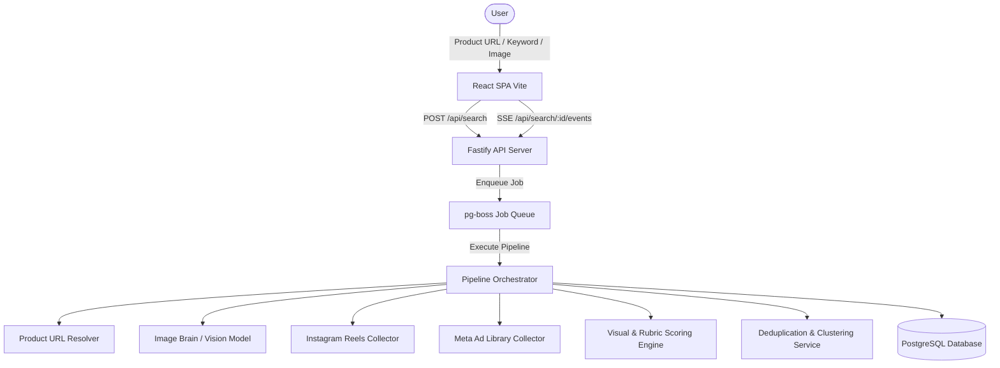

# ViDashboard - Architecture

## System Overview
ViDashboard is a high-performance Product Video Discovery Dashboard built with Node.js Fastify backend and React Vite frontend.

## Key Architectural Principles
1. **Isolated Parallel Execution**: Instagram and Meta collectors run independently in parallel via `Promise.allSettled`.
2. **Resilient SSE Replay**: Pipeline stages stream over Server-Sent Events with persistent `pipeline_events` replay using `Last-Event-ID`.
3. **Multi-tiered Scoring & Dedup**: Exact hashing, dHash perceptual hashing, caption similarity, and CLIP/VLM rubric judging.
4. **Honest Accounting**: Transparent shortfall reporting if platform limits or availability fall below target.
