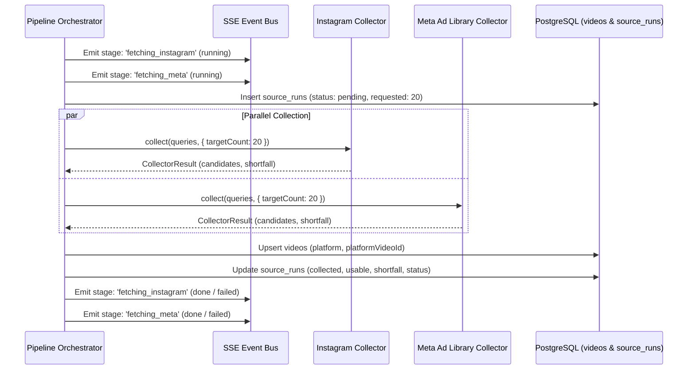

# ViDashboard - Data Sources & Collectors Architecture

## 1. Overview & Strategy

ViDashboard discovers, aggregates, and analyzes short-form video content related to a specific product or concept across major social platforms:
1. **Instagram Reels** (Meta Graph API hashtag search and media endpoints)
2. **Meta Ad Library** (Meta Graph API `ads_archive` endpoint for active & historic video ad creatives)
3. **TikTok** (Optional / Fallback video discovery)

### Collection Objectives
- **Target Yield**: A minimum of **20 raw candidate videos** per primary source per search run.
- **Parallel Isolation**: All collectors run concurrently via `Promise.allSettled` to prevent slow or failing external APIs from halting the pipeline.
- **Shortfall Accounting**: Every run explicitly tracks `requested`, `collected`, `usable`, `shortfall`, and `error` in the `source_runs` table.
- **Honest Mode Separation**: In `MODE=live`, missing tokens, rate limits, or platform restrictions are reported truthfully. Mock data is restricted exclusively to `MODE=mock` and always labeled with `isMock: true`.

---

## 2. Source 1: Instagram Reels

### 2.1 API Endpoints & Architecture
ViDashboard leverages the official Meta Graph API Instagram Graph endpoints:
1. **Hashtag Discovery**:
   - `GET https://graph.facebook.com/v19.0/ig_hashtag_search?user_id={instagram_account_id}&q={hashtag_name}`
   - Returns the unique `id` for the target hashtag.
2. **Hashtag Media Retrieval**:
   - `GET https://graph.facebook.com/v19.0/{hashtag_id}/recent_media?user_id={instagram_account_id}&fields=id,caption,media_type,media_url,permalink,thumbnail_url,timestamp,like_count,comments_count`
   - Secondary: `GET https://graph.facebook.com/v19.0/{hashtag_id}/top_media` for high-engagement anchor videos.
3. **Filtering for Reels / Videos**:
   - Filter `media_type === 'VIDEO'` to isolate Reels from static carousel/photo posts.
   - Extract video streams (`media_url`) and cover frames (`thumbnail_url`).

### 2.2 Authentication & Credentials
- **Required Token**: Long-lived User Access Token or Page Access Token with permissions:
  - `instagram_basic`
  - `pages_show_list`
  - `pages_read_engagement`
- **Environment Variable**: `INSTAGRAM_ACCESS_TOKEN`

### 2.3 Rate Limits & Platform Constraints
- **Hashtag Search Quota**: Maximum of 30 unique hashtags queried per Instagram Business Account within any 7-day rolling window.
- **User Request Rate**: 200 calls per user per hour standard Graph API rate limit.
- **Freshness Window**: `recent_media` only surfaces posts published within the prior 24 hours.

### 2.4 Shortfall Handling & Expansion Strategy
When the primary Tier 1 hashtag produces fewer than 20 videos:
1. **Tier 1 Expansion**: Query secondary product hashtags (e.g. `#lipgloss`, `#fentyglow`).
2. **Tier 2 Expansion**: Broaden to category and style concept hashtags (e.g. `#lipglossaddict`, `#makeuphaves`).
3. **Fallback Accounting**: If the quota is exhausted or fewer than 20 videos exist, the collector persists all usable records and logs the remaining shortfall in `source_runs`.

---

## 3. Source 2: Meta Ad Library

### 3.1 API Endpoints & Architecture
Meta provides access to commercial advertising creatives via the `ads_archive` Graph API:
- **Endpoint**:
  `GET https://graph.facebook.com/v19.0/ads_archive`
- **Key Parameters**:
  - `access_token`: App or User Access Token.
  - `ad_reached_countries`: `['US', 'IN', 'GB', 'CA', 'AU']` (ISO 3166-1 alpha-2 array).
  - `ad_type`: `ALL` (or `POLITICAL_AND_ISSUE_ADS` where restricted).
  - `search_terms`: Commercial keyword strings from the Query Generator (e.g. `Fenty Gloss Bomb`, `Wireless Headphones sale`).
  - `ad_active_status`: `ALL` (to discover active campaigns and historic high-performing creatives).
  - `fields`: `id,ad_creation_time,ad_creative_bodies,ad_creative_link_captions,ad_creative_link_titles,ad_delivery_start_time,ad_snapshot_url,page_id,page_name,publisher_platforms,languages`.

### 3.2 Authentication & Credentials
- **Required Token**: Meta Developer App Access Token or User Token with Ad Library API permissions.
- **Environment Variable**: `META_ACCESS_TOKEN`

### 3.3 Rate Limits & Platform Constraints
- **API Call Rate**: Standard limit of 200 calls per hour per app.
- **Snapshot URL Lifecycle**: Meta Ad Library provides `ad_snapshot_url` representing the hosted iframe. Video assets must be extracted from the snapshot DOM or creative bodies.

### 3.4 Shortfall Handling & Expansion Strategy
When exact brand/product terms produce fewer than 20 ads:
1. Expand from exact product terms (`Brand + Product`) to commercial intent terms (`Product + sale`, `Product + discount`).
2. Expand across multiple country markets (`US`, `IN`, `GB`).
3. If fewer than 20 ads exist for niche products, the collector completes with accurate accounting (`usable < 20`, `shortfall = 20 - usable`).

---

## 4. Source 3: TikTok (Optional / Fallback)

### 4.1 Overview
- TikTok discovery provides supplementary cultural video context.
- Available via TikTok Research API (enterprise) or public discovery proxies (e.g. Apify TikTok Actor).
- Configured via `TIKTOK_ACCESS_TOKEN` or `APIFY_API_TOKEN`.
- Marked as optional: failure or lack of credentials does not block the search pipeline.

---

## 5. Collector Data Contract

### 5.1 Common Video Candidate Structure
```typescript
export interface RawVideoCandidate {
  platform: 'instagram' | 'meta' | 'tiktok';
  platformVideoId: string;
  canonicalUrl: string;
  thumbnailUrl?: string;
  mediaUrl?: string;
  caption?: string;
  author?: string;
  postedAt?: Date;
  raw?: Record<string, unknown>;
  isMock: boolean;
}
```

### 5.2 Collector Result Contract
```typescript
export interface CollectorResult {
  source: 'instagram' | 'meta' | 'tiktok';
  requested: number;
  collected: number;
  usable: number;
  shortfall: number;
  candidates: RawVideoCandidate[];
  error?: string;
}
```

---

## 6. Execution Lifecycle & Pipeline Integration



---

## 7. Shortfall Recovery Protocol

If any collector returns `collected < 20`:
1. **Tier 1 (Exact)**: Check primary brand and exact product keywords.
2. **Tier 2 (Attribute Broadened)**: Broaden to dominant colors, materials, and shapes.
3. **Tier 3 (Category Discovery)**: Fall back to category-level high-traffic terms.
4. **Final Accounting**: If all expansion tiers are exhausted without reaching 20 videos, the pipeline records the truthful shortfall rather than synthesizing fake data.
